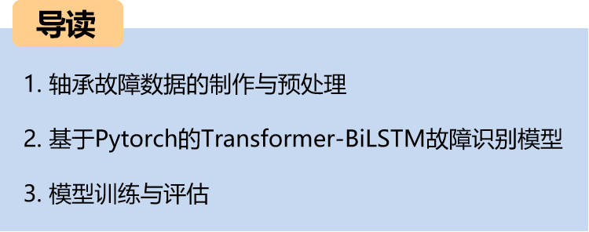
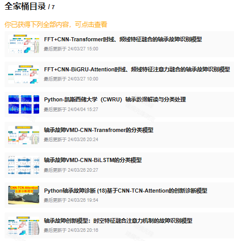
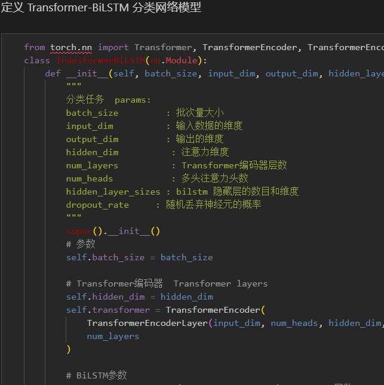
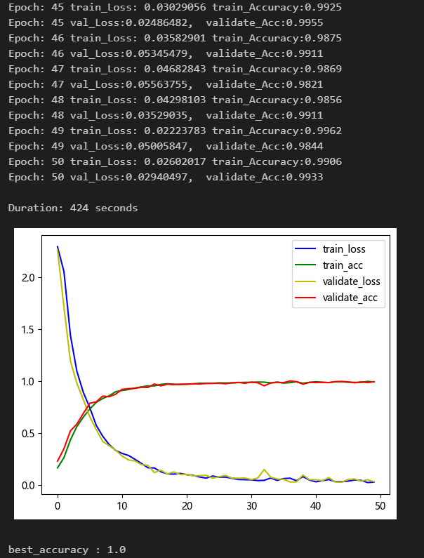
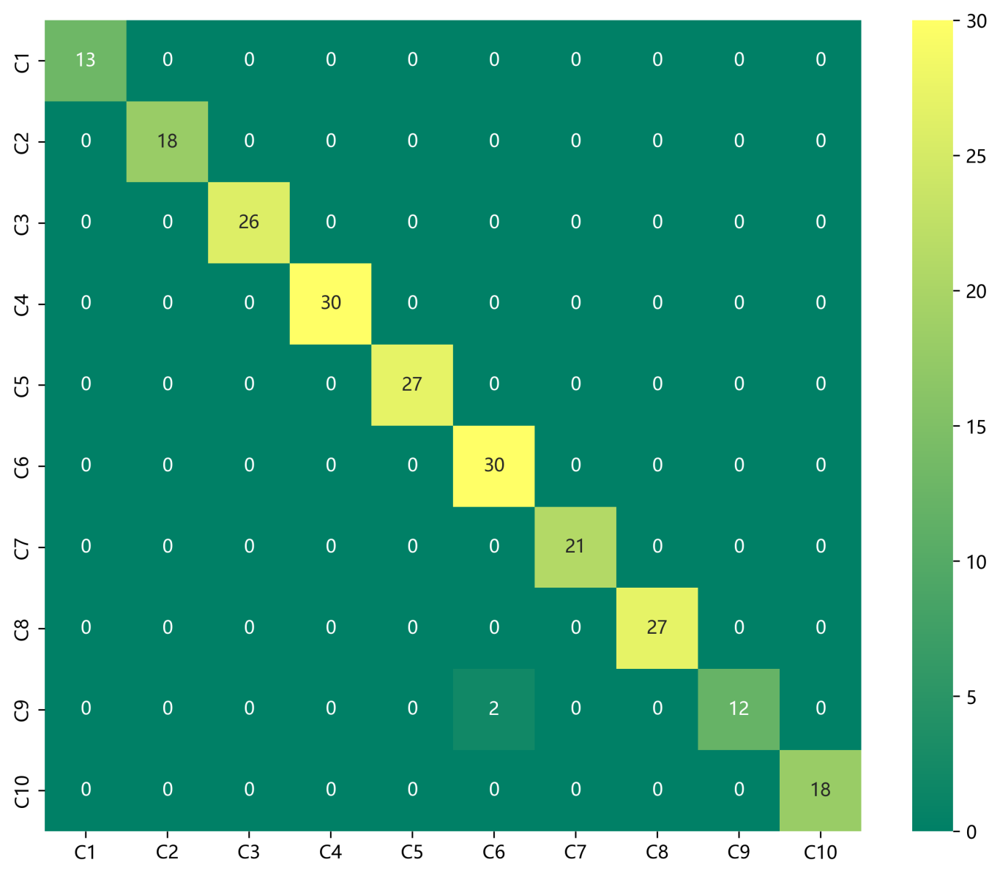
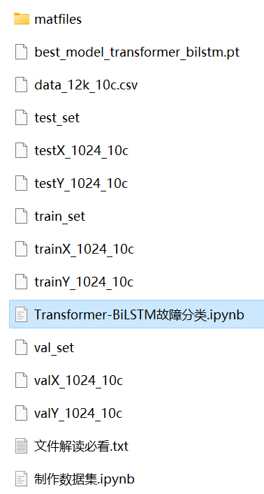

# Python Bearing Fault Diagnosis (19) Innovative Diagnosis Model Based on Transformer-BiLSTM

The translation is as follows:
Including the complete CWRU bearing fault dataset, as well as the fault signal dataset, classification data, and label set that have been generated and ready for use. The corresponding code can be run successfully.
50 epochs, with an accuracy of 100%. The Transformer-BiLSTM network has achieved significant results in classification, fully extracting the spatial, temporal, and frequency domain features of bearing fault signals. The model converges quickly and performs excellently, with high precision. Innovation is also present!!!
Includes the code for data preprocessing and the Transformer-BiLSTM classification code.
Environment: Python 3.9, PyTorch 1.8 or above.
A novel bearing fault diagnosis innovation model based on Transformer-BiLSTM:
1. Transformer:
Transformer is a deep learning model based on attention mechanisms, widely used in natural language processing tasks. It captures the dependencies between different positions in the input sequence through self-attention mechanism, effectively modeling the sequence data. In the task of bearing fault diagnosis, Transformer helps the model capture the complex correlations between different time steps in the bearing vibration signal.
2. BiLSTM:
BiLSTM is a recurrent neural network with memory units and forgetting gates, capable of effectively processing sequence data and capturing long-term dependencies in the sequence. By considering both the past and future information of the input sequence, BiLSTM can better understand the time series features and trend changes in the bearing vibration signal.
3. Model combination:
The innovative model based on Transformer-BiLSTM integrates Transformer and BiLSTM, fully leveraging their strengths. The Transformer helps the model capture global sequence information and complex dependencies, while the BiLSTM better captures local temporal features and trend changes. By combining these two models, the innovative model can achieve better performance and results in bearing fault diagnosis tasks, enhancing the accuracy and efficiency of fault diagnosis.
Preface
This paper is based on the bearing data from Case Western Reserve University (CWRU), which first undergoes preprocessing to create and load the dataset, and finally implements a Transformer-BiLSTM model for the classification of fault data through Pytorch. For a detailed introduction to the bearing data from CWRU, please refer to the following article:
Python-Case Western Reserve University (CWRU) Bearing Data Interpretation and Classification Process
1. Bearing Data Loading and Preprocessing
1.1 Import data
Refer to the previous article for preprocessing of fault classification 10, and the Case Western Reserve University bearing data set: Classification 10 dataset.
\ttrain_set, val_set, test_set are all divided into training set, validation set and test set according to the ratio of 7:2:1, and finally save the data.
The above figure is the form of data reading and preprocessing ideas.
1.2 Data preprocessing, dataset preparation
\t  
2. Innovation Diagnosis Model Based on Pytorch Transformer-BiLSTM
2.1 Define the Transformer-BiLSTM classification network model
2.2 Set parameters and train the model
50 epochs, accuracy 100%, the Transformer-BiLSTM network has a significant classification effect. The Transformer-BiLSTM model can fully extract multi-scale features of bearing fault signals, with fast convergence and exceptional performance, achieving noticeable results.

Note: Adjust parameters as needed:
- Increase the number of layers in the Transformer encoder and the dimensionality per layer, adjust learning rate;
- Tune the number of BiLSTM layers and the number of neurons per layer, increase more epochs (be cautious to prevent overfitting);
- Change the shape of one-dimensional signal stacking (set appropriate length and dimension);
- Model evaluation:
- Accuracy, Precision, Recall, F1 Score
- Fault classification confusion matrix:
- Previously excellent content:
- Python-Case Western Reserve University (CWRU) bearing data interpretation and classification processing
- Python bearing fault diagnosis (I) Short-time Fourier Transform STFT
- Python bearing fault diagnosis (II) Continuous Wavelet Transform CWT
- Python bearing fault diagnosis (III) Empirical Mode Decomposition EMD
- Pytorch-LSTM bearing fault one-dimensional signal classification (I)
- Pytorch-CNN bearing fault one-dimensional signal classification (II)
- Pytorch-Transformer bearing fault one-dimensional signal classification (III)
- Python bearing fault diagnosis (IV) Based on EMD-CNN fault classification
- Python bearing fault diagnosis (V) Based on EMD-LSTM fault classification
- Python bearing fault diagnosis (VI) Based on EMD-Transformer fault classification
- Python bearing fault diagnosis (VII) Based on EMD-CNN-LSTM fault classification
- Python bearing fault diagnosis (VIII) Based on EMD-CNN-GRU parallel model fault classification
Bearing Fault Identification Model Based on FFT + CNN - BiGRU-Attention for Time and Frequency Feature Attention Fusion
Bearing Fault Identification Model Based on FFT + CNN - Transformer Time-Domain and Frequency-Domain Feature Fusion
Python Bearing Fault Diagnosis (IX) Fault Classification Based on VMD+CNN-BiLSTM
Python Bearing Fault Diagnosis (10) Fault Classification Based on VMD+CNN-Transformer
Python Bearing Fault Diagnosis (11) Based on VMD+CNN-BiGRU-Attenion for Fault Classification
Cross Attention FFT + CNN - BiLSTM-CrossAttention Bearing Fault Identification Model
Cross Attention Fusion of Time-Domain and Frequency-Domain Features for Bearing Failure Identification Model with FFT + CNN-Transformer-CrossAttention
Python Bearing Fault Diagnosis Beginner Tutorial
Python Bearing Fault Diagnosis (13) Super-strong Machine Learning Recognition Model Based on Fault Signal Feature Extraction
Python Bearing Fault Diagnosis (14) High-Innovation Fault Identification Model
Python Bearing Fault Diagnosis (15) One-Dimensional Fault Signal Recognition Model Based on CNN-Transformer
Python Bearing Fault Diagnosis (16) High-Innovation Fault Identification Model (II)
| SCI 1 Zone High-Innovation Bearing Fault Diagnosis Model!
Python Bearing Fault Diagnosis (18) - Innovative Diagnosis Model Based on CNN-TCN-Attention
High-Innovation Bearing Fault Diagnosis Model Based on GADF+Swin-CNN-GAM
Attention Magic Mod | Superb Bearing Fault Diagnosis Model!
END  
2. Friends who enjoy the content can follow, give the article a "like", share on social media or discuss in groups.

## Images

<!-- PAYMENT_BLOCK -->

## Get this dataset

- Payment link (Stripe): [Buy now](https://buy.stripe.com/3cs8yP7sY87d0vu9AB)
- Payment QR code: 

<!-- /PAYMENT_BLOCK -->
